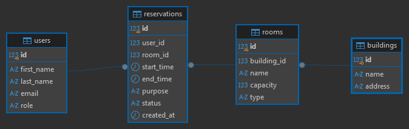

# Room Booking System

A REST API for booking classrooms and labs at a university faculty.
Users log in, browse rooms, check free time slots, make reservations and cancel them.

Built as a portfolio project with a focus on **database design**: business rules
are enforced by PostgreSQL itself, so they hold even when two requests arrive
at the same moment.

## Highlights

- **No double bookings, guaranteed by the database.** An exclusion constraint
  (`EXCLUDE USING gist`) rejects overlapping reservations for the same room,
  which an application-level "check, then insert" cannot guarantee under
  concurrent requests.
- **Free time slots computed in SQL** with a window function (`LAG`) that
  finds the gaps between reservations in a single query.
- **Measured performance work** on 2 million rows: 82 ms → 0.27 ms and
  12 ms → 0.20 ms (see [Performance](#performance)).
- **JWT authentication with roles.** Users log in with email and password
  (stored as BCrypt hashes) and receive a signed token. Users manage only their
  own reservations; admins can see and cancel all of them.
- **Versioned schema with Flyway.** Every schema change is a numbered SQL
  migration applied automatically on startup.
- **Clear error responses** (400, 401, 403, 404, 409) instead of generic server errors.
- **31 tests**: unit tests for individual classes and integration tests that
  start the whole application against a real PostgreSQL in Testcontainers.

## Database



- A **room** belongs to a **building**; a **reservation** links a **user** and a **room**.
- Rules enforced by the database:
  - a reservation lasts at most 4 hours and must end after it starts
  - active reservations of the same room cannot overlap
  - user roles and room types are limited to fixed values
- Cancelled reservations are kept with status `CANCELLED`, so history is preserved
  and the time slot becomes free again.
- Passwords are stored only as BCrypt hashes (`users.password_hash`).

The schema is created by Flyway migrations in `src/main/resources/db/migration/`:

| Migration | What it does |
|---|---|
| `V1__init_schema.sql` | tables, constraints, indexes |
| `V2__sample_data.sql` | sample users, buildings, rooms and reservations |
| `V3__add_user_password.sql` | password hash column for authentication |

## Tech stack

- Java 25
- Spring Boot 4.1 (Web MVC, Data JPA, Validation, Security)
- Spring Security OAuth2 Resource Server (JWT, HS256)
- PostgreSQL 18, Flyway
- JUnit 5, AssertJ, Testcontainers
- Docker, Docker Compose

## Getting started

### Quick start with Docker
The fastest way: no Java or PostgreSQL installation needed, only Docker.
```bash
docker compose up --build
```
This starts PostgreSQL and the application at `http://localhost:8080`.
On startup Flyway creates the tables and the sample data. Stop it with
`Ctrl + C`, then `docker compose down`.

### Running without Docker

#### Prerequisites
- JDK 25
- PostgreSQL running on `localhost:5432`

#### 1. Create an empty database
```sql
CREATE DATABASE room_booking;
```
Tables and sample data are created automatically by Flyway when the application starts.

#### 2. Set environment variables
- `DB_PASSWORD`: the PostgreSQL password (never stored in the repository)
- `JWT_SECRET` (optional): the key used to sign tokens, at least 32 characters.
  A development default is used if it is not set; always set your own outside development.

#### 3. Run the application
```bash
./mvnw spring-boot:run        # on Windows: mvnw.cmd spring-boot:run
```
The API is available at `http://localhost:8080`.

## Authentication

Sample users (all with the password `password123`):

| Email | Role |
|---|---|
| `mate@etf.rs` | STUDENT |
| `ana@etf.rs` | STUDENT |
| `petar@etf.rs` | PROFESSOR |
| `admin@etf.rs` | ADMIN |

Log in to get a token:
```json
POST /auth/login
{
    "email": "mate@etf.rs",
    "password": "password123"
}
```
```json
{ "token": "eyJhbGciOiJIUzI1NiJ9..." }
```

Send the token with every protected request:
```
Authorization: Bearer <token>
```

The token contains the user's email, id and role, and expires after 60 minutes.
The server does not keep sessions: every request is checked by verifying the
token's signature, so the API is stateless.

## API

| Method | Endpoint | Access | Description |
|---|---|---|---|
| POST | `/auth/login` | public | Log in and receive a JWT |
| GET | `/rooms` | public | List all rooms |
| GET | `/rooms/{id}/availability?date=YYYY-MM-DD` | public | Free time slots of a room on a given day (08:00–20:00) |
| GET | `/reservations/mine` | logged in | Reservations of the logged-in user |
| POST | `/reservations` | logged in | Create a reservation for the logged-in user |
| PATCH | `/reservations/{id}/cancel` | owner or admin | Cancel a reservation |
| GET | `/reservations` | admin | List all reservations |
| GET | `/reservations?userId={id}` | admin | Reservations of one user |

Example request body for `POST /reservations`
(the user is taken from the token, not from the request body):
```json
{
    "roomId": 3,
    "startTime": "2030-01-15T10:00:00",
    "endTime": "2030-01-15T12:00:00",
    "purpose": "Lab exercise"
}
```

Example response for `GET /rooms/3/availability?date=2030-01-15`
when the room is booked from 11:00 to 13:00:
```json
[
    { "freeFrom": "2030-01-15T08:00:00", "freeTo": "2030-01-15T11:00:00" },
    { "freeFrom": "2030-01-15T13:00:00", "freeTo": "2030-01-15T20:00:00" }
]
```

## Error handling

| Situation | Status |
|---|---|
| Missing or invalid fields, start time in the past | 400 Bad Request |
| End before start, or longer than 4 hours | 400 Bad Request |
| Room does not exist | 400 Bad Request |
| Missing, invalid or expired token; wrong email or password | 401 Unauthorized |
| Logged in, but not allowed (cancelling someone else's reservation, student listing all reservations) | 403 Forbidden |
| Reservation does not exist | 404 Not Found |
| Room already booked in that time slot | 409 Conflict |

Database errors are mapped to these responses by their SQLState code
(`23P01` exclusion, `23514` check, `23503` foreign key), so the rules stay
in one place: the database.

## Performance

Measured with `EXPLAIN ANALYZE` on PostgreSQL 18, with 2,000,000 reservations
generated by `database/perf-data.sql`.

| Query | Before | After | What changed |
|---|---|---|---|
| Reservations of one user | 82 ms | 0.27 ms | Added a missing index on `user_id` |
| Free time slots for a room | 12 ms | 0.20 ms | Rewrote the time filter as a range overlap (`&&`) |

**Missing foreign key index.** PostgreSQL does not index foreign keys automatically,
so looking up one user's reservations scanned all 2 million rows. A B-tree index
on `user_id` turned the sequential scan into an index scan.

**Reusing the constraint index.** The exclusion constraint that prevents overlapping
reservations is backed by a GiST index on `(room_id, tsrange(start_time, end_time))`.
The original query filtered time with two separate comparisons, so the index was used
only for the room and about 10,000 rows were checked one by one. Expressing the same
condition as a range overlap lets the existing index handle both room and time,
with no new index needed.

## Running tests

Docker must be running. Tests start their own PostgreSQL 18 container with
Testcontainers, Flyway creates the schema in it, and the container is removed
afterwards, so tests never touch development data and need no manual setup.

```bash
./mvnw test                   # on Windows: mvnw.cmd test
```

- **Unit tests** check single classes without Spring or a database: mapping
  database error codes to HTTP statuses, reservation status changes, and
  request validation.
- **Integration tests** start the whole application and send real HTTP requests:
  creating and cancelling reservations, every error response, authentication and
  role rules (401, 403), and edge cases of the free time slot query (empty day,
  reservation before opening time, cancelled reservations, other rooms).

## Project structure

```
src/main/java/com/mate/room_booking/
    room/               Room entity, repository, controller, availability service
    reservation/        Reservation entity, repository, service, controller, request DTO
    user/               User entity and repository
    security/           security rules, JWT configuration, login endpoint
    common/             global exception handler
src/main/resources/
    db/migration/       Flyway migrations (V1, V2, V3)
src/test/java/...       unit and integration tests, Testcontainers configuration
database/
    perf-data.sql       2 million rows for performance testing
Dockerfile              two-stage build: JDK to compile, JRE to run
docker-compose.yml      PostgreSQL + application, started with one command
```