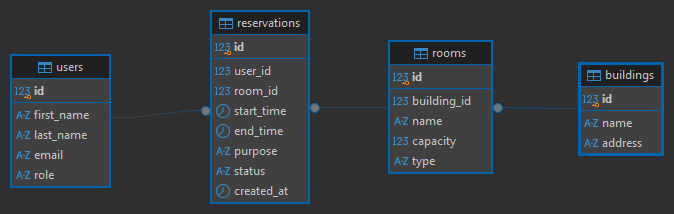

# Room Booking System

A REST API for booking classrooms and labs at a university faculty.
Users can browse rooms, check free time slots, make reservations and cancel them.

Built as a portfolio project with a focus on **database design**: business rules
are enforced by PostgreSQL itself, so they hold even when two requests arrive
at the same moment.

## Highlights

- **No double bookings, guaranteed by the database.** An exclusion constraint
  (`EXCLUDE USING gist`) rejects overlapping reservations for the same room,
  which an application-level "check, then insert" cannot guarantee under
  concurrent requests.
- **Free time slots computed in SQL** with a window function (`LAG`) that
  finds the gaps between reservations in a single query.
- **Measured performance work** on 2 million rows: 82 ms → 0.27 ms and
  12 ms → 0.20 ms (see [Performance](#performance)).
- **Clear error responses** in the standard Problem Details format
  (400, 404, 409) instead of generic server errors.
- **14 integration tests** that start the whole application and send
  real HTTP requests to it.

## Database



- A **room** belongs to a **building**; a **reservation** links a **user** and a **room**.
- Rules enforced by the database:
    - a reservation lasts at most 4 hours and must end after it starts
    - active reservations of the same room cannot overlap
    - user roles and room types are limited to fixed values
- Cancelled reservations are kept with status `CANCELLED`, so history is preserved
  and the time slot becomes free again.

## Tech stack

- Java 25
- Spring Boot 4.1 (Web MVC, Data JPA, Validation)
- PostgreSQL 18
- JUnit 5, AssertJ
- Docker, Docker Compose

## Getting started

### Quick start with Docker
The fastest way: no Java or PostgreSQL installation needed, only Docker.
```bash
docker compose up --build
```
This starts PostgreSQL, creates the tables and sample data, and runs the
application at `http://localhost:8080`. Stop it with `Ctrl + C`, then
`docker compose down`.

### Running without Docker

### Prerequisites
- JDK 25
- PostgreSQL running on `localhost:5432`

### 1. Create the database
````sql
CREATE DATABASE room_booking;
````
Then run, in this order:
1. `database/schema.sql` (tables, constraints, indexes)
2. `database/data.sql` (sample users, buildings, rooms and reservations)

### 2. Set the database password
The password is read from the `DB_PASSWORD` environment variable,
so it is never stored in the repository.

### 3. Run the application
````bash
./mvnw spring-boot:run        # on Windows: mvnw.cmd spring-boot:run
````
The API is available at `http://localhost:8080`.

## API

| Method | Endpoint | Description |
|---|---|---|
| GET | `/rooms` | List all rooms |
| GET | `/rooms/{id}/availability?date=YYYY-MM-DD` | Free time slots of a room on a given day (08:00–20:00) |
| GET | `/reservations` | List all reservations |
| GET | `/reservations?userId={id}` | Reservations of one user |
| POST | `/reservations` | Create a reservation |
| PATCH | `/reservations/{id}/cancel` | Cancel a reservation |

Example request body for `POST /reservations`:
````json
{
    "userId": 1,
    "roomId": 3,
    "startTime": "2030-01-15T10:00:00",
    "endTime": "2030-01-15T12:00:00",
    "purpose": "Lab exercise"
}
````

Example response for `GET /rooms/3/availability?date=2030-01-15`
when the room is booked from 11:00 to 13:00:
````json
[
    { "freeFrom": "2030-01-15T08:00:00", "freeTo": "2030-01-15T11:00:00" },
    { "freeFrom": "2030-01-15T13:00:00", "freeTo": "2030-01-15T20:00:00" }
]
````

## Error handling

| Situation | Status |
|---|---|
| Reservation does not exist | 404 Not Found |
| Room already booked in that time slot | 409 Conflict |
| Missing or invalid fields, start time in the past | 400 Bad Request |
| End before start, or longer than 4 hours | 400 Bad Request |
| User or room does not exist | 400 Bad Request |

Database errors are mapped to these responses by their SQLState code
(`23P01` exclusion, `23514` check, `23503` foreign key), so the rules stay
in one place: the database.

## Performance

Measured with `EXPLAIN ANALYZE` on PostgreSQL 18, with 2,000,000 reservations
generated by `database/perf-data.sql`.

| Query | Before | After | What changed |
|---|---|---|---|
| Reservations of one user | 82 ms | 0.27 ms | Added a missing index on `user_id` |
| Free time slots for a room | 12 ms | 0.20 ms | Rewrote the time filter as a range overlap (`&&`) |

**Missing foreign key index.** PostgreSQL does not index foreign keys automatically,
so looking up one user's reservations scanned all 2 million rows. A B-tree index
on `user_id` turned the sequential scan into an index scan.

**Reusing the constraint index.** The exclusion constraint that prevents overlapping
reservations is backed by a GiST index on `(room_id, tsrange(start_time, end_time))`.
The original query filtered time with two separate comparisons, so the index was used
only for the room and about 10,000 rows were checked one by one. Expressing the same
condition as a range overlap lets the existing index handle both room and time,
with no new index needed.

## Running tests

Tests use a separate database so they never touch development data.

1. Create a database named `room_booking_test`
2. Run `database/schema.sql` and `database/data.sql` on it
3. Set the `DB_PASSWORD` environment variable
4. Run:
````bash
./mvnw test                   # on Windows: mvnw.cmd test
````

The tests cover creating and cancelling reservations, every error response,
and edge cases of the free time slot query (empty day, reservation before
opening time, cancelled reservations, other rooms).

## Project structure

````
database/
    schema.sql          tables, constraints, indexes
    data.sql            sample data
    perf-data.sql       2 million rows for performance testing
src/main/java/com/mate/room_booking/
    room/               Room entity, repository, controller, availability service
    reservation/        Reservation entity, repository, controller, request DTO
    common/             global exception handler
    Dockerfile              two-stage build: JDK to compile, JRE to run
    docker-compose.yml      PostgreSQL + application, started with one command
src/test/java/...       integration tests
````
